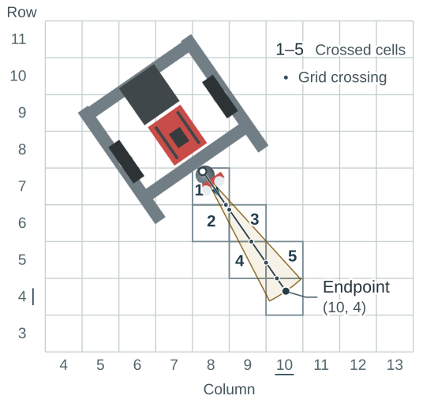
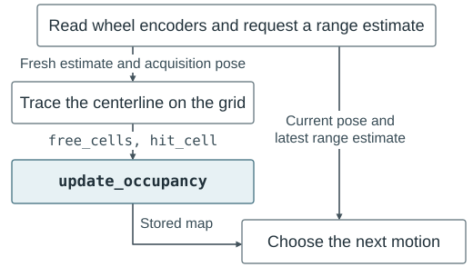

# Exercise · Reactive Driving and Mapping

The XRP knows the arena walls but starts with no observations of the posts and boxes inside. Its forward sensor sends out a pulse of sound and uses the echo’s travel time to obtain an **ultrasound range estimate**, the distance from the sensor to a reflecting surface. When the robot turns beside a post, its next range estimate may reach the far wall. How can it remember the post that is now beside the chassis?

**In class you will implement the entire `update_occupancy` function in [occupancy_update.py](occupancy_update.py).** The supplied program drives the XRP and locates each range estimate on the floor. Your function combines those observations in a map that the robot consults before its next move.

The map divides the floor into fixed squares called *cells*. **Occupancy** is the classification assigned to a cell from the observations so far. Every cell starts *unknown*. A beam passing through it provides evidence of free space. A beam ending there provides evidence that it contains a surface. Because the cells stay fixed as the XRP moves, a later observation can revise an earlier classification.

## Locating a surface

In Waypoint Courier you estimated the pose of the XRP from wheel travel. Here the same axle position and heading tell you where the sensor was pointing when it obtained a range estimate. Figure 1 shows a 198 mm estimate during a turn near a box. Any point on the arc could have produced that estimate. The program places the surface at the midpoint of the arc, straight ahead of the sensor.


*Figure 1. The sensor at \(S\) is 70 mm ahead of the axle. The range estimate extends from \(S\) to the arc. At 198 mm the arc spans about 52 mm across the beam, roughly the width of one grid cell.*

If the axle is at \((x,y)\) mm and the heading is \(\theta\) radians counterclockwise from the positive \(x\) axis, the forward direction is \(\mathbf{u}=(\cos\theta,\sin\theta)\). For a range estimate \(r\) in millimeters, the supplied code locates the sensor \(S\) and the estimated surface \(E\) using

\[
S=(x,y)+70\,\mathbf{u}, \qquad E=S+r\,\mathbf{u}.
\]

## Reading one beam on the grid

Figure 2 overlays that same line on the grid. Follow it outward from the sensor to see how one range estimate provides two kinds of evidence.



*Figure 2. The beam starts at the white dot in cell 1. Each small dark dot marks a grid boundary the centerline crosses. The two close dots near the corner of cell 2 show where the line enters and leaves that square. Cells 1 through 5 make up `crossed_cells`, in order. The larger dark dot lies in the next, unnumbered square. That square is `hit_cell`.*

For the beam in Figure 2, the supplied `beam_cells` method produces the two inputs below. Each `(column, row)` pair identifies one square and can be passed directly to the grid methods.

```python
crossed_cells = [(8, 7), (8, 6), (9, 6),
                 (9, 5), (10, 5)]
hit_cell = (10, 4)
```

When `update_occupancy(grid, crossed_cells, hit_cell)` is called, `grid` holds the classifications from earlier observations. This beam crosses five cells, but only one of them is newly observed free. Compare the last entry in `crossed_cells` with the light-blue cell labeled “Newly free” in Figure 3.


*Figure 3. The first four crossed cells were already free. Cell 5 changes from unknown to free (light blue), and the endpoint cell changes from unknown to occupied (orange). The square beyond the endpoint stays unknown (white).*

## Updating the map

Replace `pass` in [occupancy_update.py](occupancy_update.py) with the two parts of the update. Modify `grid` in place and return `None`.

1. **Process `crossed_cells`.** For each `cell`, read `grid.state(cell)`. An `UNKNOWN` cell becomes `FREE` on its first crossing, using `grid.set_state(cell, FREE)`. A `FREE` cell keeps its state. For an `OCCUPIED` cell, consider how little of cell 2 the line crossed in Figure 2. A post could occupy another part of that square. Call `grid.count_clear_pass(cell)` once and change the occupied cell to `FREE` when the returned count reaches `CLEAR_PASSES` (three by default).
2. **Process `hit_cell`.** When there is an endpoint, `grid.record_hit(hit_cell)` marks it `OCCUPIED` and resets that cell’s crossing count. This applies even when `crossed_cells` is empty. A known wall can account for a range estimate without yielding an interior endpoint. In that case `hit_cell` is `None` and only the crossings contribute to the map.

## How the robot uses the map

At its default settings, Virtual XRP requests a range estimate every control step and obtains a fresh one every other step when an echo returns (**12.5 Hz**). Between acquisitions the last result remains available. In [measured_map.py](measured_map.py), `grid.observe` checks the acquisition number so that each estimate contributes to the map just once.



*Figure 4. New observations reach `update_occupancy` along the left branch. On every control step, the robot uses its current pose, latest range estimate and stored map to choose its next motion.*

As it drives, the XRP steers through short arcs to look on either side. If a nearby surface blocks its way, it backs up and turns. The controller checks the space the whole chassis needs, so an occupied cell can affect the next move even after the sensor has turned away from it.

## Checking your update in Virtual XRP

Select **Virtual XRP** and **Side by side**. In Monitor’s **World**, choose **Course arena** with **Posts and boxes**. Use the default driving settings and leave **Show obstacles** unchecked. The unfinished starter already drives and turns, but both map counters stay at zero.

1. **Follow one cell.** Select **Compile**, open **Program output**, and select **Run**. The two **One-cell example** lines apply your function to the same cell. Read them in order. The first crossing should mark the cell free. Find the second hit and check the next three crossings. Because the hit restarted the count, their results should be *occupied, occupied, free*.
2. **Follow the drive.** Stop after the first **blocked by a mapped surface** message. Drag **World time** to the left and press **Right Arrow** to find the first map update. On this opening approach, nine light-blue cells lead to one orange endpoint. Move forward through the recording to the first turn and the approach that follows it (Figure 5).


*Figure 5. The brackets mark the same square in both views. A 226 mm range estimate placed a surface there during the turn. On the next approach the range estimate was 615 mm, and the square still lay within the dashed outline of the chassis’s next 60 mm of travel.*

Compare the range estimate in your **blocked by a mapped surface** message with the 200 mm reaction distance. Which earlier observation explains why the robot backed away?
