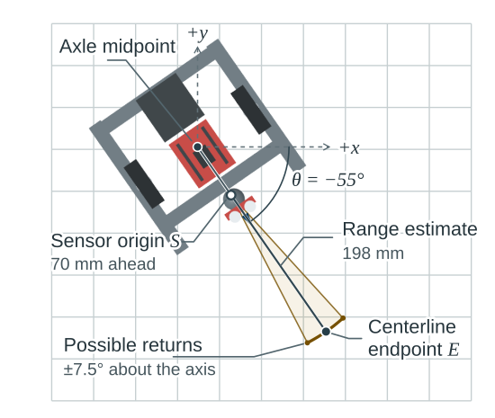
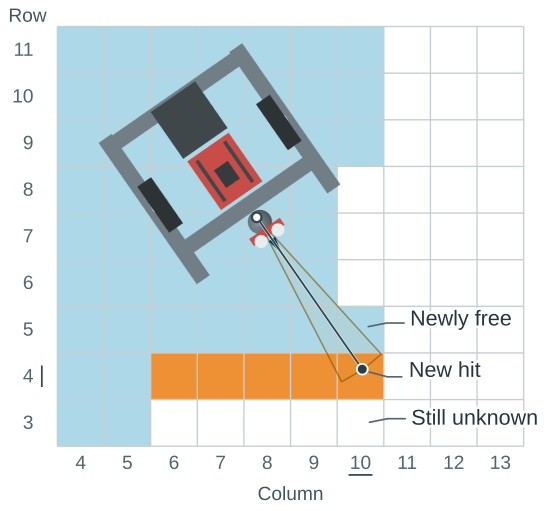
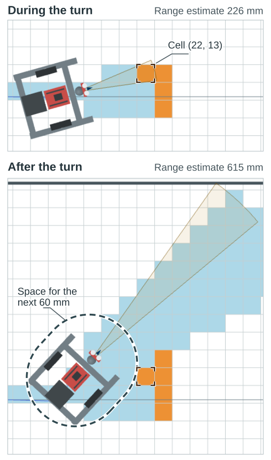

# Exercise · Reactive Driving and Mapping

The XRP drives into an arena whose outer walls it knows. The positions of the posts and boxes inside are initially unknown. Its forward sensor emits a pulse of sound and uses the time until an echo returns to obtain an **ultrasound range estimate**, the distance in millimeters from the sensor to a reflecting surface. As the robot turns to pass a post, its next range estimate may reach all the way to the far wall. The post can still be close to one side of the chassis. How could the robot take it into account on its next move?

**Your in-class task is to implement the entire `update_occupancy` function in [occupancy_update.py](occupancy_update.py).** The supplied program drives the robot and locates each range estimate on the floor. Your function updates the map the robot consults before it moves again.

The robot divides the floor into a grid of fixed squares so that successive observations of the same place can be combined, even when they were made from different positions and headings. **Occupancy** is the classification the map assigns to each square, or *cell*. A cell begins *unknown*. An estimate that places a reflecting surface in the cell gives evidence that it is *occupied*. A line from the sensor that passes through the cell on its way to a more distant surface gives evidence that it is *free*. Both classifications can change as the robot collects more evidence.

## What the range estimate locates

In Waypoint Courier you estimated the position of the axle midpoint and the robot’s heading from wheel travel. Here that position and heading, together called the *pose*, let you locate a surface in the arena. Figure 1 follows one range estimate obtained as the XRP turned near a box. The sensor sits 70 mm in front of the axle and faces along the robot’s forward axis. At the instant shown it obtained a range estimate of 198 mm. In this top view the possible reflecting points lie on an arc within 7.5° on either side of the sensor axis. The range estimate alone cannot distinguish their directions. The program uses the point directly ahead as its estimate of the surface position.



*Figure 1. Follow the centerline from the axle to the sensor and then from the sensor to the arc. Only the second distance is the range estimate. At 198 mm the possible positions span about 52 mm across the cone, roughly one grid cell. Selecting the midpoint of the arc can place the surface in a neighboring cell.*

Write \(S\) for the sensor position and \(E\) for the estimated surface position, both in millimeters in the arena. If the axle is at \((x,y)\) and the heading is \(\theta\), then \(\mathbf{u}=(\cos\theta,\sin\theta)\) points along the centerline. Heading is measured in radians, counterclockwise from the arena’s positive \(x\) axis. For a range estimate \(r\), the supplied geometry computes

\[
S=(x,y)+70\,\mathbf{u}, \qquad E=S+r\,\mathbf{u}.
\]

The calculation uses the pose when the estimate was obtained. In Figure 1 the chassis points about 55° clockwise from the positive \(x\) axis, so the line from sensor to surface runs east and south.

## From the projected line to map cells

In world coordinates the origin is the arena center. Grid addresses start at a different place and count cells. Cell `(0, 0)` is at the southwest corner. An address is `(column, row)`, with columns increasing eastward and rows northward. To find a cell, the program measures east and north from that corner and divides each distance by the 50 mm cell size. For example, \(E\) is at approximately \((-997,-377)\) mm in world coordinates, or 527 mm east and 233 mm north of the southwest corner. Ten whole cell widths fit into the first distance and four into the second. The estimated surface position is therefore in cell `(10, 4)`.

Now trace the line in Figure 2 with your finger, starting at the sensor. Within a square, moving farther along the line leaves its address unchanged. In this example each crossing changes either the column or the row. This is how the supplied `beam_cells` method converts a continuous line into an ordered sequence of cells.


*Figure 2. Begin in column 8, row 7. The first crossing takes you south into row 6. The next takes you east into column 9 while you are still in row 6. Follow the remaining crossings and compare their order with the arguments below.*

The supplied program handles this geometry. When it calls `update_occupancy(grid, free_cells, hit_cell)`, `grid` is the same `MeasuredMap` object that holds the classifications from earlier estimates. The other two arguments for Figure 2 are shown below.

```python
free_cells = [(8, 7), (8, 6), (9, 6),
              (9, 5), (10, 5)]
hit_cell = (10, 4)
```

The two inputs describe evidence from **one** range estimate. A cell in `free_cells` may already be free, may still be unknown, or may have been marked occupied on an earlier pass. The endpoint is kept separate because a surface may be present there. A second surface could be hidden beyond it, so the line ends at the first surface. Figure 3 shows how much of this particular observation was new.



*Figure 3. Four cells along this line were already free. The last crossed cell, `(10, 5)`, changes from unknown to free (light blue). The endpoint cell, `(10, 4)`, changes from unknown to occupied (orange). The cell just beyond it, `(10, 3)`, stays unknown (white).*

Sometimes there are crossed cells and no interior endpoint. For example, a known arena wall can explain the range estimate, or the surface can lie beyond the 750 mm mapping distance. The program can still trace the part of the line within the map and mapping distance. It passes `None` for `hit_cell` in these cases. A missing range estimate or one below the 20 mm mapping minimum supplies no cells to update.

## Implementing the map update

Open [occupancy_update.py](occupancy_update.py). Replace `pass` with the full body of `update_occupancy`. The function changes the existing `grid` in place and returns `None`. The imports above it give you the three state names and the crossing threshold.

**Process the crossed cells.** Consider each cell in `free_cells` in turn. Use `grid.state(cell)` to find its current classification. A crossing is enough to change an `UNKNOWN` cell to `FREE` with `grid.set_state(cell, FREE)`. A cell already marked `FREE` needs no further change.

Now suppose a later line passes through `(10, 4)`, the orange cell in Figure 3, and ends farther away. A line can pass through an empty corner of a cell that also contains part of a post. A single crossing therefore gives little reason to discard the earlier hit. When a crossed cell is `OCCUPIED`, `grid.count_clear_pass(cell)` records one crossing for that cell and returns its new count. Change its classification to `FREE` when that count reaches `CLEAR_PASSES`, which [settings.py](settings.py) sets to three. Observations elsewhere leave its count intact.

**Record the endpoint.** After processing the crossed cells, consider `hit_cell` independently. When an endpoint is present, `grid.record_hit(hit_cell)` marks that cell `OCCUPIED` and restarts its crossing count, even if it was already occupied. This also handles a short line that ends in the sensor’s own cell, for which `free_cells` can be empty. Cells absent from both arguments keep their evidence for a later call.

## Where your function runs

[main.py](main.py) asks the robot for a range estimate on each 40 ms control step and obtains its pose from wheel travel. The ranging service needs at least 70 ms between acquisitions. With these defaults Virtual XRP makes a new attempt every other step, giving a new range estimate every **80 ms (12.5 Hz)** when a surface returns an echo. Between acquisitions it holds the previous result. A held result must never count as another crossing.


*Figure 4. A control step can produce a driving command even when there is no new map evidence. When there is new evidence, your function updates the stored map before the robot chooses its next motion.*

The call `grid.observe(robot.range_sample_seq, state)` in [main.py](main.py) passes the acquisition number and the robot state, which contains the pose and range estimate. The `observe` method in [measured_map.py](measured_map.py) recognizes a new acquisition by its number. It then calls `beam_cells` in [occupancy_map.py](occupancy_map.py), checks the endpoint against the known walls and calls your function when there is evidence to record. The same `grid` persists throughout the drive. Monitor’s **World** view displays its changing classifications.

The robot normally drives forward. It steers through short arcs to look to either side and backs away and turns when forward travel is blocked. These turns let the fixed sensor observe places off the original line of travel. Before advancing, the controller checks both the latest range estimate and the space the whole chassis would sweep, using the occupied cells and the known walls.

## Seeing the result in Virtual XRP

Select **Virtual XRP** and **Side by side**. In Monitor’s **World**, use **Course arena** with **Posts and boxes**, leave **Show obstacles** unchecked and keep the default driving settings. With the unfinished starter the robot can already drive and turn, while both cell counts stay at zero.

1. **Follow one cell.** Suppose a line first crosses an unknown cell, an estimate then ends in it, and the next two lines cross it. Now suppose a second estimate ends there, followed by three crossings. Predict when the cell will become free again. Select **Compile**, open **Program output** and select **Run**. The two **One-cell example** lines apply this exact sequence to a separate cell using your function. Read the lines together. After the second hit the final three crossings should give *occupied, occupied, free*.
2. **Follow the drive.** Let the robot approach the post, turn away and begin its next approach. Select **Stop** when **blocked by a mapped surface** appears in **Program output**. Drag **World time** to the left and use **Right Arrow** to find the first update. On this first approach, before the turn illustrated in Figures 1–3, nine light-blue free cells lead to one orange occupied cell. You can now move forward through the recording to see how the map affected the next approach (Figure 5).



*Figure 5. The corner marks identify the same square in both views. During the turn a 226 mm range estimate placed a surface there. On the next approach the range estimate was 615 mm, but the square still intersected the dashed outline of the chassis’s next 60 mm of travel.*

In the run in Figure 5, one line crossed the marked square after it had been hit. Was that enough evidence to clear it? Compare the range estimate at the **blocked by a mapped surface** message in your run with the 200 mm immediate reaction distance. Find the occupied cell beside the chassis in the second view. Could the robot have decided to retreat there using its current range estimate alone?
